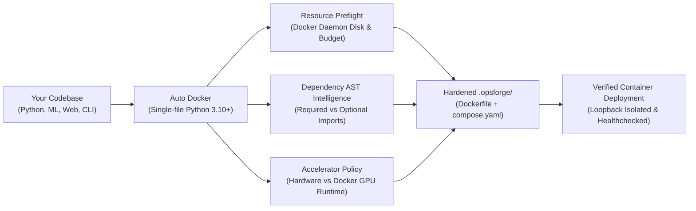

# Auto Docker 3.0

[](LICENSE)
[](pyproject.toml)
[](RELEASE_NOTES.md)
[-success.svg)](requirements.txt)
[](https://github.com/chavalasantosh/AutoDocker/actions)
[-brightgreen.svg)](TEST_REPORT.md)
[](https://github.com/chavalasantosh/AutoDocker/actions)

> **Autonomous, zero-dependency, resource-aware container infrastructure assistant and deployment orchestrator in a single Python executable.**
>
> 📖 **New to Docker or just joined the team?** Run `python auto_docker.py guide` or read our 60-second [New Teammate Guide](TEAM_ONBOARDING.md).

---

## Table of Contents

- [Overview](#overview)
- [Why Auto Docker? (The Differentiation)](#why-auto-docker-the-differentiation)
- [Key Features](#key-features)
- [Core Architecture & Deep-Dives](#core-architecture--deep-dives)
  - [1. Predictive Docker Resource Budget Engine](#1-predictive-docker-resource-budget-engine)
  - [2. Dependency Intelligence 2.0](#2-dependency-intelligence-20)
  - [3. Safe CPU/GPU Accelerator Policy](#3-safe-cpugpu-accelerator-policy)
  - [4. Conflict Guardian & Network Isolation](#4-conflict-guardian--network-isolation)
  - [5. Non-Destructive File Generation Contract](#5-non-destructive-file-generation-contract)
  - [6. Scoped Docker Resource Cleaner](#6-scoped-docker-resource-cleaner)
- [Getting Started & Workflow Modes](#getting-started--workflow-modes)
  - [Mode 1: SMART Mode (Zero Docker Jargon)](#mode-1-smart-mode-zero-docker-jargon)
  - [Mode 2: Auto-Pilot 3-Step Wizard](#mode-2-auto-pilot-3-step-wizard)
  - [Mode 3: Interactive Developer Workbench](#mode-3-interactive-developer-workbench)
  - [Mode 4: Headless CLI & CI/CD Automation](#mode-4-headless-cli--cicd-automation)
- [Workload Profiles & Multi-Service Stacks](#workload-profiles--multi-service-stacks)
- [Complete CLI Command & Flag Reference](#complete-cli-command--flag-reference)
- [Real-World Case Studies](#real-world-case-studies)
  - [Case Study A: Standard FastAPI Microservice](#case-study-a-standard-fastapi-microservice)
  - [Case Study B: Enterprise AutoML (Preventing Disk Exhaustion)](#case-study-b-enterprise-automl-preventing-disk-exhaustion)
- [Quality Release Gates & Tested Matrix](#quality-release-gates--tested-matrix)
- [Limitations & Honest Boundaries](#limitations--honest-boundaries)
- [Development & Automated Testing](#development--automated-testing)
- [License & Community](#license--community)

---

## Overview

**Auto Docker** transforms any Python, Machine Learning, GenAI, or multi-service codebase into hardened, reproducible Docker and Docker Compose environments in seconds.

It operates under four strict engineering commitments:
1. **Zero External Dependencies**: Operates 100% out-of-the-box using the standard Python 3.10+ library. No `pip install` required for Auto Docker itself.
2. **Predictive Resource Safety**: Checks actual Docker Engine disk space before building, predicting image layer expansion to prevent catastrophic `no space left on device` crashes.
3. **Non-Destructive Guarantee**: Generates all files strictly in `.opsforge/`. Never touches, mutates, or overwrites your root files or existing Compose configurations without confirmation.
4. **Honest, Explainable Automation**: Replaces black-box guessing with evidence-based verdicts (`CONFIRMED`, `INFERRED`, `WARNING`, `BLOCKED`, `UNKNOWN`).



---

## Why Auto Docker? (The Differentiation)

Existing tools like `docker init` or Cloud Native Buildpacks generate container definitions or build images. However, when moving from trivial hello-world apps to real-world machine learning, data science, or enterprise codebases, developers encounter critical pain points:

| Challenge | Standard Tools (`docker init`, Buildpacks) | Auto Docker 3.0 |
| :--- | :--- | :--- |
| **Disk Exhaustion Mid-Build** | Blindly pulls and extracts layers until host storage is exhausted (`no space left on device`). | **Resource Budget Engine**: Computes lower/upper layer expansion boundaries against actual Docker storage before running `docker build`. |
| **Heavy Optional ML Imports** | Bundles every imported module into the container image, inflating images by multiple gigabytes. | **AST Segregation**: Separates top-level required imports from guarded optional libraries (`try...except`, dynamic functions). |
| **PyTorch / Accelerator Bloat** | Often installs 3+ GiB of CUDA/NVIDIA dependencies even on CPU-only machines. | **Accelerator Policy**: Verifies active Docker GPU runtime support; installs official lightweight CPU wheels (`--index-url`) when appropriate. |
| **Host Port Collisions** | Fails with `bind: address already in use` (`EADDRINUSE`) if port 8000 is occupied. | **Conflict Guardian**: Discovers local port conflicts and automatically relocates services to the next available non-colliding port. |
| **Network Security** | Default bindings often expose containers to all interfaces (`0.0.0.0`). | **Strict Loopback**: Binds exclusively to `127.0.0.1` by default; enforces non-root container user (`app:app`). |
| **File Overwrite Risks** | Prompts to overwrite your existing `Dockerfile` and `compose.yaml` in the root folder. | **Isolated Generation**: All generated files live in `.opsforge/`; archives previous configurations with 1-command rollback. |
| **Tooling Dependencies** | Requires node, npm, go, or third-party pip packages to run the orchestrator. | **Zero Dependencies**: Entire engine resides in a single self-contained file (`auto_docker.py`). |

---

## Key Features

- **Single Master Executable (`auto_docker.py`)**: A single file containing the inspection engine, AST parser, planning engine, template renderer, Docker process adapter, resource cleaner, and 354 automated regression tests.
- **SMART Mode (`auto_docker.py` or `python auto_docker.py smart`)**: A unified, zero-jargon terminal experience designed for developers and data scientists who have no prior Docker experience.
- **Predictive Resource Budgeting (RC10)**: Real-time daemon storage probing (`/var/lib/docker`) and pre-build disk exhaustion prevention.
- **Dependency Intelligence 2.0**: AST import visitor separating required from guarded optional imports, 300+ standard-library immunity modules, and 120+ PyPI canonical alias mappings.
- **Auto-Pilot Quick-Start Wizard**: 3-step guided deployment (`Detect -> Configure -> Safe Deploy`).
- **Dedicated Scoped Resource Cleaner**: Non-destructive discovery and removal of disposable test containers, project-tagged images, and orphaned resources without risking unrelated containers or named volumes.
- **MLOps Persistent State Mounts**: Automatically detects and mounts model and data folders (`artifacts/`, `models/`, `runs/`, `checkpoints/`, `data/`) so your training outputs are preserved on your host machine.
- **Horizontal Scalability & Observability**: Support for `deploy.replicas` with non-colliding host port mapping ranges, CPU/memory resource limits, and optional automated Prometheus and Grafana monitoring stacks.

---

## Core Architecture & Deep-Dives

```text
┌─────────────────────────────────────────────────────────────────────────────┐
│                              AUTO DOCKER CORE                               │
├─────────────────┬─────────────────┬───────────────────┬─────────────────────┤
│ Storage Probe   │ Dependency AST  │ Accelerator Policy│ Port & Lock Manager │
│ & Budget Engine │ Intelligence    │ (CPU/GPU wheels)  │ (Conflict Guardian) │
├─────────────────┴─────────────────┴───────────────────┴─────────────────────┤
│                         SMART DECISION ENGINE                               │
│        (Structured Evidence: CONFIRMED | INFERRED | UNKNOWN | BLOCKED)       │
├───────────────────────────────────┬─────────────────────────────────────────┤
│         PLANNING ENGINE           │          RENDERER & SECURITY            │
│   (Graph Topological Order,       │    (Multi-stage Dockerfile, loopback    │
│    Resource Limits, Volume Mounts)│     compose.yaml, non-root user)        │
├───────────────────────────────────┴─────────────────────────────────────────┤
│                          OUTPUT MANAGER (.opsforge/)                        │
│   (Timestamped backups, state recovery, immutable DeploymentDigest)         │
├─────────────────────────────────────────────────────────────────────────────┤
│                         DOCKER ADAPTER & CLEANER                            │
│   (Readiness probes, scoped container cleanup, health verification)         │
└─────────────────────────────────────────────────────────────────────────────┘
```

### 1. Predictive Docker Resource Budget Engine

When containerizing complex machine learning or data pipelines, Docker images often exceed 2 to 4 GiB during build cache generation and layer extraction. If the host running the Docker Engine has insufficient disk headroom, the build crashes mid-stream:

```text
failed to extract layer ... no space left on device
```

Auto Docker introduces a non-destructive **Resource Preflight**:
1. **Actual Daemon Storage Probing (`DockerStorageProbe`)**: Rather than checking the project filesystem (which may be on a different drive or mount), Auto Docker queries `docker info --format {{.DockerRootDir}}` to identify the daemon storage path (e.g. `/var/lib/docker`), and probes its available space via `shutil.disk_usage`.
2. **VM & Remote Isolation Handling**: When Docker runs inside an isolated virtual machine (such as Docker Desktop on macOS or Hyper-V/WSL2 on Windows) or over a remote SSH/TCP context, host path inspection is physically disconnected from daemon disk. Auto Docker honestly reports `UNKNOWN` rather than providing false confidence.
3. **Reclaimable Space Discovery**: Queries `docker system df` in read-only mode to report reclaimable build cache and dangling images without running destructive prune commands.
4. **Estimated Storage Budget Ranges (`ResourceBudgetEstimator`)**: Analyzes the Python base image, wheels for declared and inferred dependencies, and intermediate build cache layers to compute a lower (`min_gib`) and upper (`max_gib`) bound with a mandatory 1.0 GiB safety reserve headroom.

#### Storage Verdict Classifications
- `SUFFICIENT`: Verified disk capacity exceeds estimated maximum build requirements with comfortable headroom.
- `WARNING`: Headroom is tight (available storage is close to estimated requirements with $< 1.0$ GiB buffer).
- `BLOCKED`: Available storage is strictly lower than the minimum estimated footprint. Auto Docker halts the build at preflight before expensive downloads or writes begin.
- `UNKNOWN`: Remote or isolated daemon storage; prints recommended minimum free space to check manually.

---

### 2. Dependency Intelligence 2.0

Auto Docker's `DependencyAstVisitor` performs abstract syntax tree analysis directly on your Python entrypoints and local modules without importing or executing untrusted code:

- **Guarded vs. Unconditional Import Segregation**:
  - `REQUIRED_CANDIDATE`: Unconditional top-level imports that execute upon application startup (e.g. `import fastapi`, `import numpy`).
  - `OPTIONAL_CANDIDATE`: Imports placed inside `try...except ImportError` blocks, runtime functions, or dynamic conditional branches (e.g. optional ML backends like `catboost`, `lightgbm`, `xgboost`).
  - **Result**: Inferred builds remain minimal and fast. Optional heavy libraries are highlighted for operator confirmation rather than blindly pulled into the base container image.
- **Standard Library Immunity**: Over 300 Python standard library modules (`json`, `sqlite3`, `pathlib`, `logging`, `dataclasses`, `asyncio`, `multiprocessing`, `urllib`, etc.) are recognized and never misclassified as external pip dependencies.
- **120+ Curated PyPI Canonical Aliases**: Resolves import module names to their correct distribution names:
  - `cv2` $\to$ `opencv-python`
  - `PIL` $\to$ `Pillow`
  - `yaml` $\to$ `PyYAML`
  - `dotenv` $\to$ `python-dotenv`
  - `bs4` $\to$ `beautifulsoup4`
  - `psycopg2` $\to$ `psycopg2-binary`
  - `sklearn` $\to$ `scikit-learn`
  - `fitz` $\to$ `PyMuPDF`
- **Multi-Manifest Discovery**: Statically discovers and parses `requirements.txt`, `pyproject.toml`, `setup.cfg`, `setup.py`, `Pipfile`, and `environment.yml`. User-provided manifests always remain the primary source of truth.

---

### 3. Safe CPU/GPU Accelerator Policy

Installing machine learning frameworks often results in massive images due to embedded CUDA/CUDNN binaries (e.g., PyTorch with CUDA wheels can exceed 2.5 GiB).

Auto Docker's `AcceleratorPolicy` implements a safe, platform-aware installation policy:
1. **Hardware vs. Docker Daemon Distinction**:
   - Queries `nvidia-smi` to detect physical GPU hardware.
   - Queries `docker info --format '{{json .Runtimes}}'` to determine whether Docker is configured with the `nvidia` container runtime.
   - If physical GPU hardware exists but Docker lacks the NVIDIA runtime, Auto Docker flags this configuration honestly (`GPU detected on host, but Docker lacks 'nvidia' container runtime`).
2. **Safe PyPI CPU Wheel Routing**:
   - For CPU-only deployments using PyTorch, Auto Docker configures the official separate CPU wheel index:
     ```dockerfile
     RUN pip install --no-cache-dir torch torchvision torchaudio --index-url https://download.pytorch.org/whl/cpu
     ```
   - **Security Guarantee**: Auto Docker strictly avoids `--extra-index-url`, preventing PyPI index confusion vulnerabilities where malicious packages on public repositories could take precedence over internal or hardware-specific wheels.
3. **No Unsolicited Alterations**: If your application does not import accelerator-dependent packages, Auto Docker never introduces them.

---

### 4. Conflict Guardian & Network Isolation

- **Default Loopback Binding**: Every generated service binds strictly to `127.0.0.1` (e.g. `127.0.0.1:8000:8000`). This ensures local microservices, test databases, and admin dashboards are never unintentionally exposed to local networks or public interfaces.
- **Port Conflict Relocation**: During preflight, `PortAudit` checks whether your designated host port is already occupied by another running application. If a conflict is detected, Auto Docker automatically relocates your container port to the next free port (e.g. `8001`), eliminating runtime `bind: address already in use` failures.
- **Multi-Replica Expansion**: When running multiple replicas (`--replicas 3`), Auto Docker automatically maps a non-colliding port range (e.g. `127.0.0.1:8000-8002:8000`).

---

### 5. Non-Destructive File Generation Contract

Auto Docker strictly enforces an isolated workspace layout:

```text
your_project/
├── app.py
├── requirements.txt
├── artifacts/                           <-- Preserved & mounted automatically
└── .opsforge/                           <-- All generated files live exclusively here!
    ├── Dockerfile                       <-- Multi-stage, non-root builder & runtime
    ├── compose.yaml                     <-- Loopback bound services & volume mounts
    ├── Dockerfile.dockerignore          <-- Context exclusions (.git, venv, pycache)
    ├── manifest.json                    <-- Cryptographic hashes and runtime metadata
    └── INSTRUCTIONS.txt                 <-- Verification instructions & quick commands
```

- **Zero Overwrite of Root Files**: Auto Docker **never** writes or overwrites a `Dockerfile` or `compose.yaml` in your project root.
- **Automatic Versioned Backups**: Prior to modifying any existing `.opsforge/` deployment, Auto Docker archives the previous configuration into `.opsforge-backup-<timestamp>/`.
- **Instant Rollback**: If a new configuration does not behave as expected, rollback immediately with:
  ```bash
  python auto_docker.py recover /path/to/project --yes
  ```
- **Existing Infrastructure Preservation**: If your project already has root `compose.yaml` or `Dockerfile` files, Auto Docker acts as a non-destructive validator and orchestrator, executing and verifying your stack without modifying your existing files.

---

### 6. Scoped Docker Resource Cleaner

Auto Docker includes a built-in cleaner that manages containers, images, volumes, and networks created during test runs and development:

```bash
# Safe dry-run scan (read-only preview of resources)
python auto_docker.py clean

# Remove disposable test containers, images, and networks
python auto_docker.py clean --clean-test --yes

# Remove all resources belonging to a specific project
python auto_docker.py clean --project /path/to/project --yes

# Clean orphaned containers from interrupted runs
python auto_docker.py clean --orphans --yes
```

#### Cleaner Safety Rules
1. **Never Runs `docker system prune`**: Unrestricted system prunes can wipe out unrelated databases, global caches, and other projects on your machine. Auto Docker only touches resources matching explicit ownership labels.
2. **Volume Protection**: Named volumes are preserved by default (`--preserve-volumes`), preventing data loss in local databases or model checkpoint folders.
3. **Ownership Tagging**: Distinguishes project-owned containers, test-tagged temporary resources, and unmanaged host infrastructure.

---

## Getting Started & Workflow Modes

Auto Docker provides four tailored workflows depending on your use case and familiarity with containers:

```text
┌────────────────────────────────────────────────────────────────────────┐
│                        CHOOSE YOUR WORKFLOW                            │
├───────────────────┬───────────────────┬────────────────────────────────┤
│ 1. SMART Mode     │ 2. Auto-Pilot     │ 3. Developer                   │
│ (Zero Jargon)     │ (3-Step Wizard)   │ Workbench                      │
│ python auto_docker│ python auto_docker│ python auto_docker console     │
│   (Hit [ENTER])   │   wizard          │                                │
├───────────────────┴───────────────────┴────────────────────────────────┤
│ 4. Headless CLI / CI Automation (python auto_docker.py generate --yes) │
└────────────────────────────────────────────────────────────────────────┘
```

### Mode 1: SMART Mode (Zero Docker Jargon)

Designed for teammates, students, and engineers who want to run code in a container without learning Docker commands.

Run Auto Docker in your terminal:
```bash
python auto_docker.py
```
*(Or specify a folder or script directly: `python auto_docker.py /path/to/project` or `python auto_docker.py app.py`)*

#### The SMART Experience:
1. **Project Understanding**: Auto Docker scans your entrypoint, framework, dependencies, ports, storage, and Docker Engine status, rendering structured findings:
   ```text
   ================================================================================
   AUTO DOCKER — SMART: Project Understanding
   ================================================================================
   Project Name     : recommendation-api
   Language         : Python / FastAPI application [CONFIRMED]
   Entrypoint       : app.py (score: 95) [CONFIRMED]
   Dependencies     : Manifest verified: requirements.txt [CONFIRMED]
   Persistent Data  : Data folders detected: artifacts, models [CONFIRMED]
   Application Port : Port 8000 -> 8000 (available) [CONFIRMED]
   Docker Storage   : 42.5 GiB free on Docker disk (Estimated build: 0.3 - 0.6 GiB) [SUFFICIENT]
   Accelerator      : Standard CPU runtime [CONFIRMED]
   --------------------------------------------------------------------------------
   Evidence Assessment: 6 CONFIRMED | 1 INFERRED | 0 UNKNOWN | 0 BLOCKED
   --------------------------------------------------------------------------------
   Next Steps:
     Press [ENTER] or '1' to Prepare Deployment Plan
     Type 'fix' or '2' to Customize or Resolve Issues
     Type '0' or 'back' to Return to SMART Home
   ================================================================================
   ```
2. **Review & Approval**: Displays the exact actions that will take place and requires an explicit confirmation (`YES`).
3. **Verified Launch**: Builds the container, starts services, probes health endpoints, and prints the verified local web address (e.g. `http://localhost:8000`).

---

### Mode 2: Auto-Pilot 3-Step Wizard

For guided configuration toggles without diving into full console menus:

```bash
python auto_docker.py wizard
# or
python auto_docker.py quick /path/to/project
```

- **Step 1: Detection** — Scans and summarizes entrypoint, detected framework, and storage directories.
- **Step 2: Configuration** — Interactively customize workload mode, port overrides, replicas, and dependency policy.
- **Step 3: Safe Deploy** — Runs preflight verification and triggers deployment or dry-run inspection.

---

### Mode 3: Interactive Developer Workbench

For full manual control over every configuration layer:

```bash
python auto_docker.py console
```

Provides immediate access to:
- Project switching and settings modification
- Workload profile selection (`base`, `mlops`, `llmops`, `genaiops`)
- Service overrides and execution kind (`auto`, `web`, `batch`, `interactive`)
- Lock inspection and manual lock clearing
- Output backup recovery
- Scoped Docker resource cleanup

---

### Mode 4: Headless CLI & CI/CD Automation

For non-interactive scripting, build servers, and automated pipelines:

```bash
# 1. Inspect codebase and return JSON deployment plan
python auto_docker.py inspect /path/to/project

# 2. Preview generated Dockerfile and compose.yaml in terminal
python auto_docker.py preview /path/to/project --full

# 3. Generate hardened infrastructure into .opsforge/
python auto_docker.py generate /path/to/project --yes

# 4. Validate configuration syntax offline (zero Docker daemon required)
python auto_docker.py check /path/to/project

# 5. Build and launch services in detached mode
python auto_docker.py build /path/to/project --yes
python auto_docker.py up /path/to/project --yes

# 6. Verify container health states and probe HTTP endpoints
python auto_docker.py verify /path/to/project
python auto_docker.py smoke /path/to/project --smoke-path /healthz --expect 200

# 7. Safe cleanup of test resources
python auto_docker.py clean --project /path/to/project --yes
```

---

## Workload Profiles & Multi-Service Stacks

Auto Docker can provision and link auxiliary development microservices based on your application's workload profile:

| Profile | Target Use Case | Auxiliary Microservices Included | Default Ports |
| :--- | :--- | :--- | :--- |
| `auto` | Automatic heuristic detection based on code imports | Inferred from codebase | Matches app |
| `base` | Standard web services, APIs, and batch jobs | Core application container only | App port |
| `mlops` | Machine learning experiment tracking and model training | Core application + **MLflow Tracking Server** | App port, `mlflow:5000` |
| `llmops` | Local LLM inference, embedding, and RAG pipelines | Core application + **Ollama Local AI Runner** | App port, `ollama:11434` |
| `genaiops` | Full GenAI production stack with caching & observability | Application + **Ollama** + **Redis** + **Prometheus** + **Grafana** | App port, `11434`, `6379`, `9090`, `3000` |

### Persistent Volume Auto-Mounts
For data science and ML workloads, Auto Docker scans for persistent data folders and automatically configures host volume mounts in `compose.yaml`:

```yaml
volumes:
  - ../artifacts:/app/artifacts
  - ../models:/app/models
  - ../data:/app/data
```

Detected directory patterns include: `artifacts`, `models`, `runs`, `checkpoints`, `data`, `datasets`, `storage`, `outputs`, `logs`, `weights`, and `db`.

---

## Complete CLI Command & Flag Reference

### Subcommands

| Command | Usage | Description |
| :--- | :--- | :--- |
| `smart` | `python auto_docker.py smart [path]` | Launches one-command SMART Mode (default when path is passed directly). |
| `guide` | `python auto_docker.py guide` | Interactive 60-second onboarding guide for new teammates. |
| `wizard` | `python auto_docker.py wizard [path]` | Launches 3-step Quick-Start Auto-Pilot wizard. |
| `console` | `python auto_docker.py console [path]` | Opens interactive developer terminal workbench. |
| `inspect` | `python auto_docker.py inspect [path]` | Inspects project and displays detected framework, entrypoint, and dependencies. |
| `preview` | `python auto_docker.py preview [path]` | Previews generated file list or full contents (`--full`). |
| `generate`| `python auto_docker.py generate [path] --yes` | Generates hardened container files in `.opsforge/`. |
| `check` | `python auto_docker.py check [path]` | Validates generated configuration syntax and Compose structure. |
| `doctor` | `python auto_docker.py doctor [path]` | Read-only audit of host environment, Docker daemon, and GPU support. |
| `audit` | `python auto_docker.py audit [path]` | Offline static security and configuration audit. |
| `smoke` | `python auto_docker.py smoke [path]` | Performs HTTP health probe against running container. |
| `preflight`| `python auto_docker.py preflight [path]` | Runs pre-deployment preflight check and displays review plan. |
| `build` | `python auto_docker.py build [path] --yes` | Builds container image via Docker Engine. |
| `up` | `python auto_docker.py up [path] --yes` | Starts container services in detached mode. |
| `run` | `python auto_docker.py run [path] --yes` | Runs an interactive CLI application with attached terminal TTY. |
| `job` | `python auto_docker.py job [path] --yes` | Executes a batch job and cleans up on exit (`--rm`). |
| `verify` | `python auto_docker.py verify [path]` | Verifies container runtime health and readiness status. |
| `diagnose`| `python auto_docker.py diagnose [path]` | Displays container diagnostic hints and troubleshooting suggestions. |
| `clean` | `python auto_docker.py clean [flags]` | Scoped Docker resource cleaner (dry-run by default). |
| `lock` | `python auto_docker.py lock [path]` | Displays active concurrency lock status for project. |
| `unlock` | `python auto_docker.py unlock [path] --yes` | Safely clears verified stale concurrency locks. |
| `recover` | `python auto_docker.py recover [path] --yes` | Restores previous `.opsforge/` deployment from latest backup. |
| `self-test`| `python auto_docker.py self-test` | Executes complete 354-test automated regression suite. |

### Global Flags

| Flag | Applicable Commands | Description |
| :--- | :--- | :--- |
| `--yes`, `-y` | `generate`, `build`, `up`, `clean`, `recover` | Explicit non-interactive confirmation for scripts and CI/CD pipelines. |
| `--mode` | `generate`, `preview`, `wizard`, `console` | Selects workload profile (`auto`, `base`, `mlops`, `llmops`, `genaiops`). |
| `--port` | `generate`, `preview`, `wizard` | Overrides application published host port (1024–65535). |
| `--kind` | `generate`, `preview`, `wizard` | Overrides execution kind (`auto`, `web`, `batch`, `interactive`). |
| `--gpu` | `generate`, `preview`, `wizard` | Explicitly enables GPU device reservation. |
| `--replicas`| `generate`, `preview` | Sets horizontal service replica count with automated port ranges. |
| `--context` | All Docker commands | Directs Docker commands to a specific Docker context (local or remote). |
| `--allow-insecure` | `build`, `up`, `generate` | Explicitly permits high-risk configurations (privileged mode, socket mounts). |
| `--smoke-path` | `smoke` | Endpoint path for HTTP smoke validation (default: `/`). |
| `--expect` | `smoke` | Expected HTTP response code (default: `200`). |
| `--clean-test` | `clean` | Targets disposable test containers and temporary networks. |
| `--project` | `clean` | Targets all Docker resources tagged with a specific project root. |
| `--orphans` | `clean` | Discovers and targets stopped containers from interrupted previous runs. |
| `--preserve-volumes` | `clean` | Preserves named volumes during cleanup (enabled by default). |

---

## Real-World Case Studies

### Case Study A: Standard FastAPI Microservice

**Scenario**: A teammate clones a FastAPI service with an `app.py` entrypoint and a `requirements.txt` manifest:

```bash
python auto_docker.py /path/to/my_fastapi_app
```

**Auto Docker Execution**:
1. Recognizes FastAPI framework and selects port `8000`.
2. Verifies `uvicorn` is present; flags an advisory if `uvicorn` was omitted from `requirements.txt`.
3. Binds exclusively to `127.0.0.1:8000`. If port 8000 is occupied, automatically relocates to `8001`.
4. Generates multi-stage Alpine/Slim Dockerfile with non-root user `app:app`.
5. Starts the service and verifies HTTP readiness.

---

### Case Study B: Enterprise AutoML (Preventing Disk Exhaustion)

**Scenario**: An AutoML repository (`enterprise_automl_v3_2.py`) imports 14 heavy libraries:
`catboost`, `lightgbm`, `xgboost`, `mlflow`, `scikit-learn`, `scipy`, `statsmodels`, `fastapi`, `joblib`, and `kafka`. The build runs on a server with **2.1 GiB of free Docker disk space**.

```bash
python auto_docker.py preview enterprise_automl_v3_2.py
```

**What Happens**:
1. **AST Scope Classification**: Auto Docker parses the file and discovers that `catboost`, `lightgbm`, `xgboost`, and `mlflow` are wrapped in `try...except ImportError` blocks. They are classified as `OPTIONAL_CANDIDATE` packages and omitted from the default base build, keeping the image footprint lightweight (~350 MB).
2. **Resource Budget Engine**: If dependency inference is enabled to include all packages, the budget engine calculates:
   - Estimated build requires: **1.9 GiB – 3.3 GiB**.
   - Minimum required headroom buffer: **1.0 GiB**.
3. **Verdict**:
   ```text
   Docker Storage : 2.1 GiB free on Docker disk (Estimated build: 1.9 - 3.3 GiB) [WARNING]
   Explanation    : Heavy ML/computation packages detected: catboost, lightgbm, mlflow, scipy, xgboost.
                    Storage WARNING: Estimated build needs 1.9 - 3.3 GiB. Headroom is tight 
                    (2.1 GiB free, < 1.0 GiB safety buffer).
   Recommendation : Build might exhaust disk if layers are not cached. Review heavy packages or free up space.
   ```
4. **Halt on Insufficient Space**: If available storage drops to 1.5 GiB, Auto Docker returns `StorageVerdict.BLOCKED` and **halts deployment before running `docker build`**, preventing host disk exhaustion and layer extraction crashes.

---

## Quality Release Gates & Tested Matrix

Auto Docker is developed and tested against 14 automated release gates:

| Gate | Area | Guarantee |
| :---: | :--- | :--- |
| **G1** | Baseline Suite | 100% backward compatibility across all legacy baseline tests. |
| **G2** | Large-Scale Repositories | Successfully audits repositories with 1,000+ files without timeouts or recursion errors. |
| **G3** | Secrets & Precedence | Session-local HMAC redaction; `.env` precedence strictly enforced. |
| **G4** | Infrastructure Protection | Pre-existing `compose.yaml` files are preserved byte-for-byte. |
| **G5** | Deterministic Planning | Topological dependency sort produces identical hash fingerprints across runs. |
| **G6** | Security Enforcement | Privileged containers, root Docker socket mounts, and `0.0.0.0` databases blocked by default. |
| **G7** | Daemon Health Check | Accurate probing of Docker CLI, Compose, and daemon reachability. |
| **G8** | Readiness Engine | Distinguishes verified healthy services from unverified containers without healthchecks. |
| **G9** | Failure Recovery | Clean state machine rollback and scoped container cleanup. |
| **G10** | Zero External Dependencies | Single master executable (`auto_docker.py`) using only Python standard library. |
| **G11** | Guided Quick-Start | 3-step wizard and automated persistent volume detection. |
| **G12** | Enterprise Observability | Multi-replica port mapping and automated Prometheus/Grafana service stacks. |
| **G13** | Scoped Resource Cleanup | Non-destructive resource cleaner with strict ownership tagging. |
| **G14** | Dependency Intelligence | Standard library immunity, PyPI alias resolution, and guarded import segregation. |

### Cross-Platform CI Matrix

Auto Docker is verified across 16 parallel CI jobs on GitHub Actions on every commit:

| Operating System | Python 3.10 | Python 3.11 | Python 3.12 | Python 3.13 |
| :--- | :---: | :---: | :---: | :---: |
| **Ubuntu Linux** (`ubuntu-latest`) | ✅ PASS | ✅ PASS | ✅ PASS | ✅ PASS |
| **macOS** (`macos-latest`) | ✅ PASS | ✅ PASS | ✅ PASS | ✅ PASS |
| **Windows** (`windows-latest`) | ✅ PASS | ✅ PASS | ✅ PASS | ✅ PASS |

Additional security checks:
- **Bandit AST Static Security Analysis**: 0 vulnerabilities.
- **Git Secret & Credential Leak Detection**: 0 leaked credentials.

---

## Limitations & Honest Boundaries

To ensure confidence in production environments, Auto Docker operates under clear, documented boundaries:

1. **Static AST Analysis Boundaries**: Auto Docker inspects imports statically. It cannot predict imports constructed via runtime string concatenation (e.g. `importlib.import_module("my_" + "package")`). Review your dependency manifest for dynamically loaded plugins.
2. **Virtual Machine Storage Boundaries**: When Docker Engine runs inside an isolated virtual machine (such as Docker Desktop on macOS or Hyper-V/WSL2 on Windows) without host daemon socket access, host storage queries cannot reflect VM disk capacity. In these environments, Auto Docker reports storage as `[UNKNOWN]` and displays the recommended free space for manual verification.
3. **No Automatic Database Deletion**: Auto Docker's resource cleaner will never delete or prune named Docker volumes without explicit operator flags. Your database data and model weights are preserved.
4. **Local Infrastructure Focus**: Auto Docker is a local development and staging orchestration engine. It is not a replacement for Kubernetes or cloud orchestration tools like Terraform.

---

## Development & Automated Testing

Auto Docker includes a built-in regression suite containing **354 automated unit, integration, and platform tests**.

To execute the test suite locally:

```bash
python auto_docker.py self-test
```

Execution takes under 25 seconds on modern hardware with zero setup or external packages required.

To run specific test methods or view detailed verbose output:
```bash
python -m unittest auto_docker.py
```

---

## License & Community

Auto Docker is open-source software licensed under the **[Apache License, Version 2.0](LICENSE)**.

Copyright 2026 Chavala Santosh.
